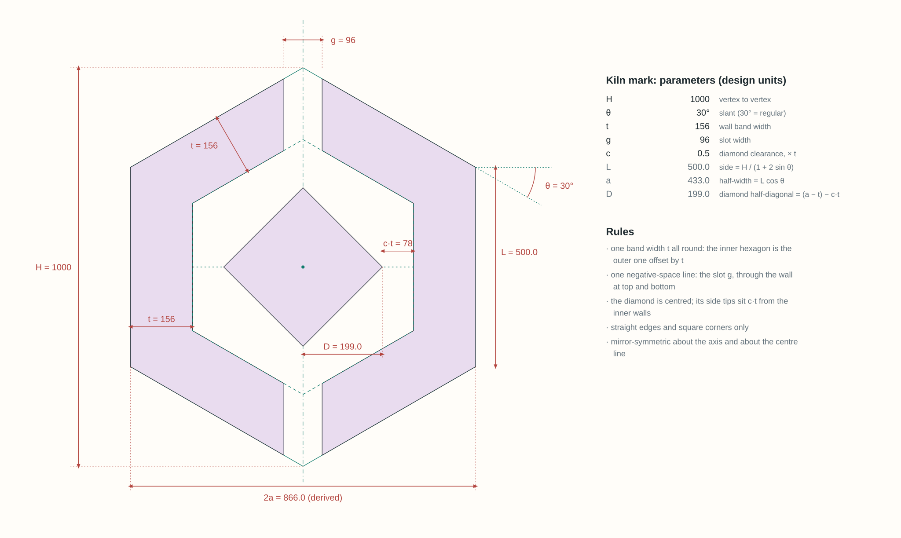

# The kiln mark: construction

Design units: the hexagon is 1000 tall, vertex to vertex. y points down, and the axis is x = 0.

## Parameters

| Name | Value | Meaning |
|---|---|---|
| H | 1000 | the hexagon, vertex to vertex |
| θ | 30° | the slope of the four slanted sides; 30° makes the hexagon regular |
| t | 156 | the wall: one band width all round |
| g | 96 | the slot: the one negative-space line |
| c | 0.5 | the diamond's clearance from the inner walls, as a share of t |

| Derived | Value | From |
|---|---|---|
| L | 500.0 | the side length, H / (1 + 2 sin θ) |
| a | 433.0 | the half-width, L cos θ |
| D | 199.0 | the diamond's half-diagonal, (a − t) − c·t |

[kiln-mark.params.json](kiln-mark.params.json) holds the five parameters.

## Steps

1. **The hexagon.** Its vertices are (0, 0), (a, L sin θ), (a, H − L sin θ), (0, H), (−a, H − L sin θ) and
   (−a, L sin θ).
2. **The wall.** Subtract the inner hexagon: the outer one with every side moved inward by t along its normal.
   The wall is t wide everywhere, on the slanted sides as well as the upright ones.
3. **The slot.** Subtract a vertical band g wide, centred on the axis, through the wall at the top and the
   bottom. It cuts the two vertices off, so the mark is 944.6 tall, not 1000.
4. **The diamond.** Add a square standing on its corner, with half-diagonal D, centred at (0, H / 2). Its side
   points sit c·t = 78 from the inner walls: half a wall.

## Rules

- One band width all round.
- One negative-space line, the slot, at the top and the bottom.
- The diamond is centred.
- Straight edges and square corners only.
- Mirror-symmetric about the axis and about the horizontal centre line.

## The small cut

For 48 px and below: t 176, g 120, c 0.4. The heavier wall and wider slot survive at 16 px. The smaller
clearance keeps the diamond large enough to read
([kiln-mark-small.params.json](kiln-mark-small.params.json)).

## Against the concept

The concept (2026-11-06) is followed except where a rule overrides it:

- **The hexagon is regular.** The concept's is equilateral but about 9% taller, with its slanted sides at about
  34°. The regular hexagon was chosen on 2026-11-12.
- **The diamond** has half-diagonal 199, against about 198 in the concept.
