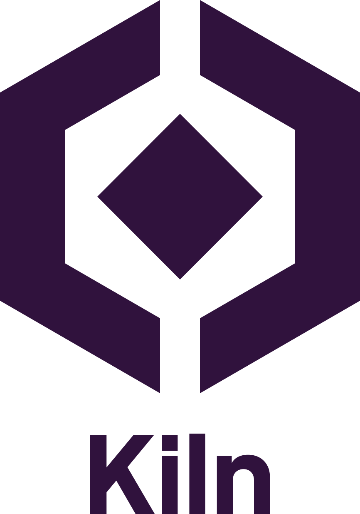

  <picture>
    <source media="(prefers-color-scheme: dark)" srcset="svg/kiln-lockup-stacked-cream.svg">
    
  </picture>

# The kiln logo

The mark is a hexagonal kiln wall, split at the top and the bottom by one slot, around the piece being fired: a
square standing on its corner. It is built from five numbers, not drawn by hand.
[CONSTRUCTION.md](CONSTRUCTION.md) gives the geometry, and
[kiln-mark-construction.svg](kiln-mark-construction.svg) is the dimensioned drawing.

kiln and easel share one family: the same plum and cream, straight edges and square corners only, and the same
motif, a square on its corner.

## Colours

| Name | Hex | Use |
|---|---|---|
| plum | `#30123D` | the mark on light grounds; the dark ground |
| cream | `#F0E6DA` | the mark on dark grounds; the light icon's ground |
| paper | `#FDFBFC` | the light page |

Every pairing is far above the 3:1 that graphics need: plum on paper 15.9:1, plum on cream and cream on plum
13.0:1. Black and white are for one-colour print. The `mono` files take the colour of the surrounding text
(`currentColor`).

## Which file to use

| For | Use |
|---|---|
| A README header, light theme | `app-slots/readme-light.svg` |
| A README header, dark theme | `app-slots/readme-dark.svg` |
| An app icon on a dark ground | `app-slots/icon-dark.svg` |
| An app icon on a light ground | `app-slots/icon-light.svg` |
| A favicon | `icons/favicon.svg` |
| The mark alone | `svg/kiln-plum.svg` on light grounds, `svg/kiln-cream.svg` on dark ones |
| The mark with the name | `svg/kiln-lockup-stacked-*.svg` (the name under the mark) or `svg/kiln-lockup-horizontal-*.svg` (the name beside it) |
| The name alone | `svg/kiln-wordmark-*.svg` |
| 48 px and below | `svg/kiln-small-*.svg` |
| One colour | `svg/kiln-mono.svg`, `svg/kiln-black.svg`, `svg/kiln-white.svg` |
| On a busy ground | a tile (`svg/kiln-tile-*.svg`), a circle (`svg/kiln-circle-*.svg`) or a knockout (`svg/kiln-knockout-*.svg`) |
| Line art | `svg/kiln-outline-*.svg` |
| A social preview (1200 × 630) | `icons/og-image.svg` |

Each file is cropped tight to its shape, with no padding.

## Small sizes

At 48 px and below, use the small cut, `svg/kiln-small-*.svg`. Its parameters are in
[kiln-mark-small.params.json](kiln-mark-small.params.json). Its wall is heavier (176 against 156) and its slot
wider (120 against 96), so at 16 px the slot stays open and the diamond stays clear of the wall. The favicon
uses it already, and `svg/kiln-small-tile-plum-rounded.svg` is a small app icon.

## The name

The name is set in Plus Jakarta Sans ExtraBold (weight 800), with the font's own kerning, and converted to
outlines: no font is needed to show it. The typeface is by the Plus Jakarta Sans Project Authors, under the SIL
Open Font License 1.1, which allows this use. The placement is fixed, and
[lockups.params.json](lockups.params.json) records it:

- **Stacked:** the cap height is 0.19 of the mark's height H, and the cap line sits 0.10 H below the mark,
  centred on its axis.
- **Horizontal:** the cap height is 0.36 H. The name starts 0.22 H after the mark, its capitals centred on the
  mark's middle.

Use these files rather than typing the name beside the mark.

## Clear space and minimum size

- Keep clear space of at least a quarter of the mark's height on every side.
- The mark: no smaller than 16 px, in the small cut.
- The stacked lockup: no smaller than 96 px tall.
- The horizontal lockup: no smaller than 40 px tall.

## Don'ts

- Don't stretch, rotate or crop the mark.
- Don't add shadows, gradients or outlines to it.
- Don't recolour it outside the palette. On a photograph or a busy ground, use a tile.
- Don't edit the files by hand. They are generated from the parameter files; to change the logo, open an issue.

## Checked

[VERIFY.txt](VERIFY.txt) records the symmetry, measured on a render at 4 pixels per unit:
- the two upright walls are both 156 wide, equally far from the axis;
- the diamond is centred;
- the mirror image differs in 756 pixels against 18,296 edge pixels (4.1%), which is anti-aliasing along the
  slanted edges.
